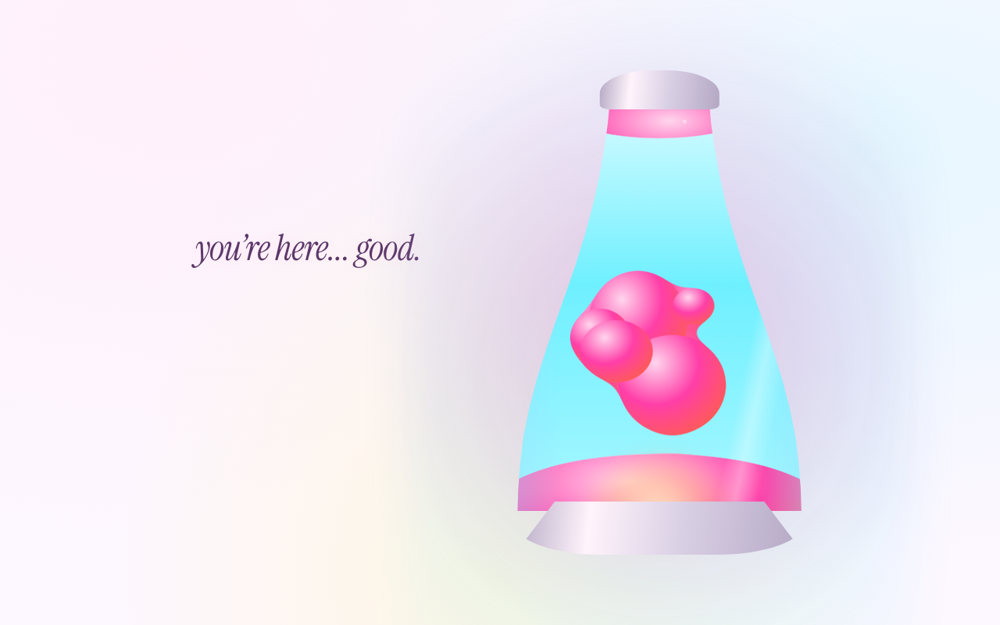
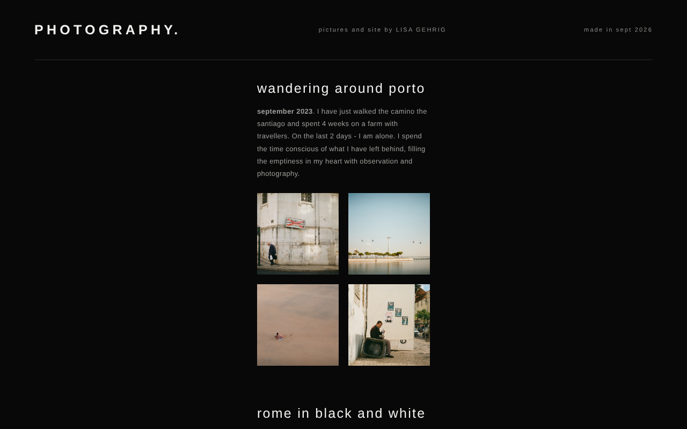
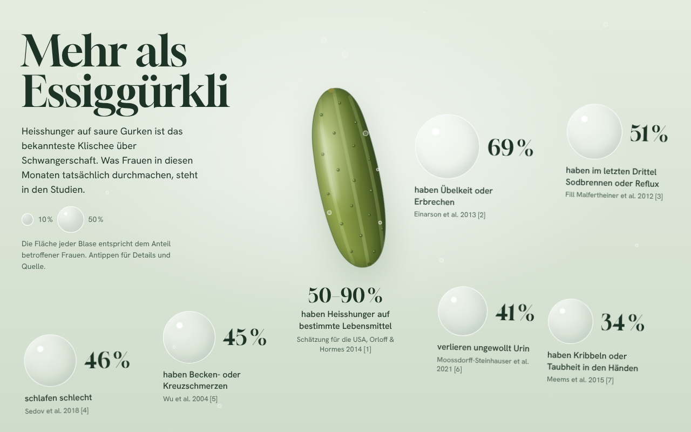

# lisa-gehrig

My personal website – a small collection of hand-built static pages.
Plain HTML, CSS and JavaScript: no framework, no build step.



## Pages

| Page | Folder | What it is |
|------|--------|------------|
| **Lava lamp** | [`/`](index.html) | A calm landing page with an animated SVG lava lamp (metaball "goo" filter, CSS animations, scroll reveal via `IntersectionObserver`) |
| **Photography** | [`photography/`](photography) | A gallery of my own photo series with a full-size lightbox viewer; collections are generated from a simple config in `photos.js` |
| **Writing** | [`writing/`](writing) | Short texts, rendered from a data structure inside the page |
| **Music** | [`music/`](music) | Make-music-with-me page: a cassette player for the radio single, a strip of songs & clips, a playable toy piano with a "jam with me" chord loop, and a contact sheet that writes the e-mail for you |
| **Mehr als Essiggürkli** | [`anna_gubler/`](anna_gubler) | An illustrated data story (German) about what pregnancy is really like, with study references |

<p>
  
  
</p>

## Highlights

- Responsive layouts and `prefers-reduced-motion` support
- Pure SVG/CSS animation instead of video or canvas libraries
- Zero dependencies – each page is self-contained and can be opened directly

## Run locally

Open `index.html` in a browser, or serve the folder:

```bash
python -m http.server
```

## Structure

```
├── index.html            landing page
├── icon.png
├── photography/          index.html · style.css · app.js · photos.js · images/<series>/<n>.jpg
├── writing/              index.html
├── music/                index.html · style.css · items.js · app.js · piano.js · media/
├── anna_gubler/          data story (+ second version in 2/)
└── docs/                 screenshots for this README
```

To add a photo series, drop the pictures into `photography/images/<n>/` and
update `photoCounts` in `photography/photos.js` and the section text in
`photography/app.js`.

## Music page

Everything in the strip (songs, clips, the band) is listed in
[`music/items.js`](music/items.js), one block per card: title, colour, story,
credits and links. Change the text there; no other file needs touching.

To add a clip, put the video into `music/media/clips/` and write its path
into the card's `video` field, e.g. `video: "media/clips/all-i-need.mp4"`.
Until then the card says *coming soon*.

Other texts (intro, "more about me", "let's make something") are plain HTML
in [`music/index.html`](music/index.html).

The server needs to support HTTP range requests so the song can be skipped
through (nginx, Apache, Caddy and GitHub Pages all do;
`python -m http.server` doesn't, but playback still works there).
