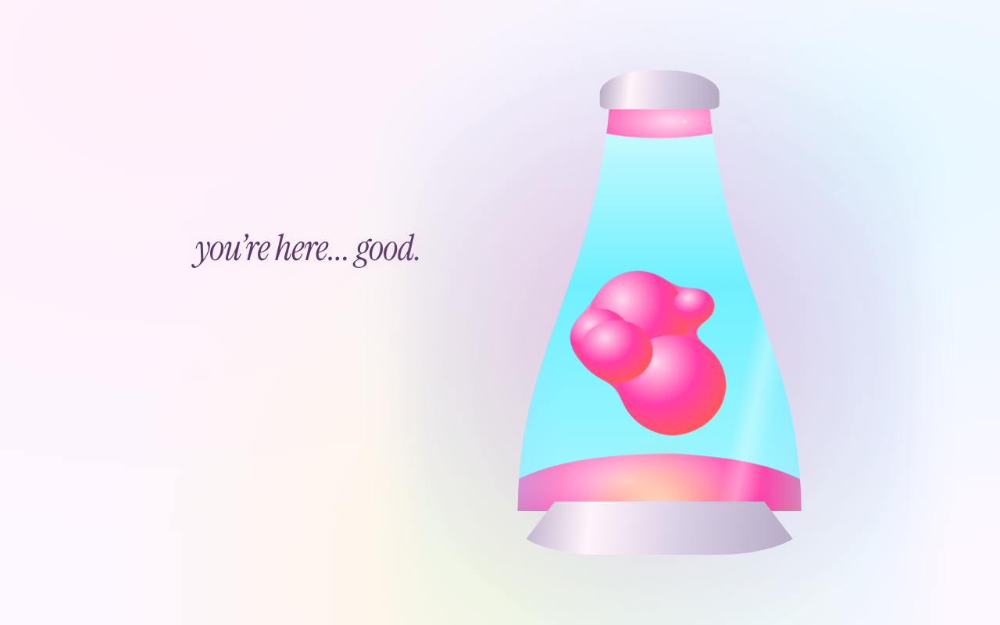
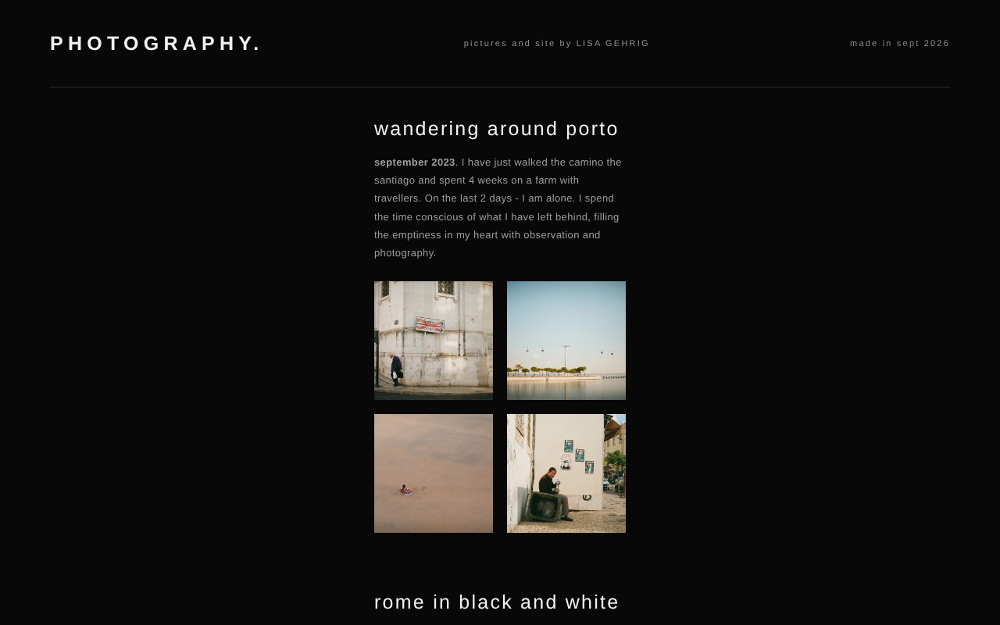
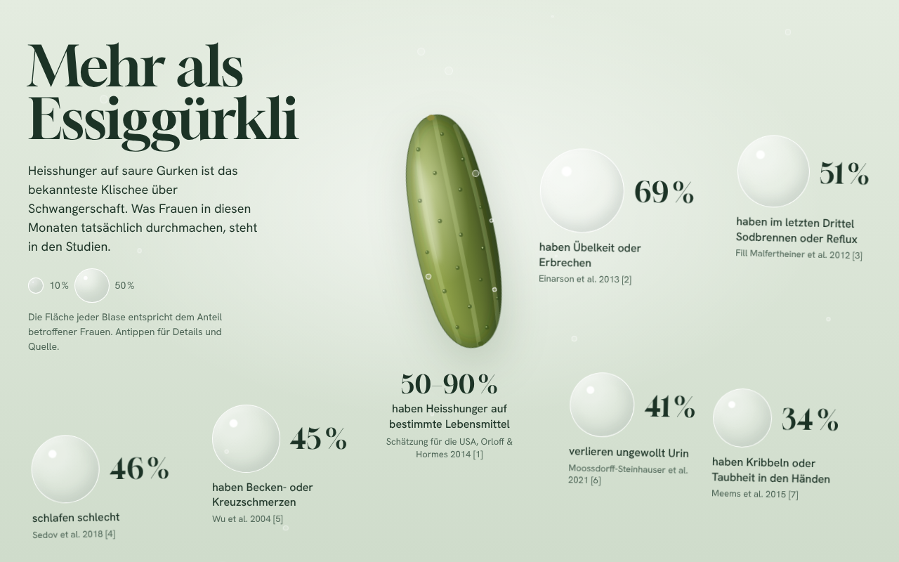

# lisa-gehrig

My personal website – a small collection of hand-built static pages.
Plain HTML, CSS and JavaScript: no framework, no build step.



## Pages

| Page | Folder | What it is |
|------|--------|------------|
| **Lava lamp** | [`/`](index.html) | A calm landing page with an animated SVG lava lamp (metaball "goo" filter, CSS animations, scroll reveal via `IntersectionObserver`) |
| **Photography** | [`photography/`](photography) | A gallery of my own photo series with a full-size lightbox viewer; collections are generated from a simple config in `photos.js` |
| **Writing** | [`writing/`](writing) | Short texts, rendered from a data structure inside the page |
| **Mehr als Essiggürkli** | [`anna_gubler/`](anna_gubler) | An illustrated data story (German) about what pregnancy is really like, with study references |

<p>
  
  
</p>

## Highlights

- Responsive layouts and `prefers-reduced-motion` support
- Pure SVG/CSS animation instead of video or canvas libraries
- Zero dependencies – each page is self-contained and can be opened directly

## Run locally

Open `index.html` in a browser, or serve the folder:

```bash
python -m http.server
```

## Structure

```
├── index.html            landing page
├── icon.png
├── photography/          index.html · style.css · app.js · photos.js · images/<series>/<n>.jpg
├── writing/              index.html
├── anna_gubler/          data story (+ second version in 2/)
└── docs/                 screenshots for this README
```

To add a photo series, drop the pictures into `photography/images/<n>/` and
update `photoCounts` in `photography/photos.js` and the section text in
`photography/app.js`.
